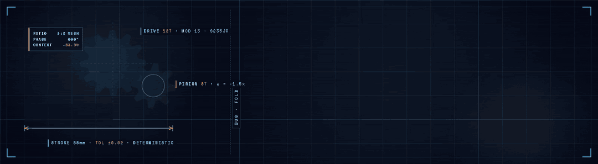

<div align="center">
  
  <p><strong>Software, built the way a machine is built.</strong></p>

  <a href="https://github.com/777marvin/ext-broke/releases"></a>
  <a href="https://github.com/777marvin/ext-broke/actions/workflows/ci.yml"></a>
  <a href="https://github.com/777marvin/ext-broke/blob/main/LICENSE"></a>
  <a href="https://www.linkedin.com/in/marvin-knabe/"></a>
  <a href="mailto:777marvin.dev@proton.me"></a>
</div>

---

## WHAT I DO

I come from machine technology. I build software the way I would build a
machine — from a specification and a defined process, not ad-hoc prompts.
AI agents do the execution; I write the specs, direct the workflow, and review
the output.

My focus sits where the two fields meet: **mechanical-engineering knowledge and
AI-agent development**.

## WHAT I BUILD

**[ext-broke](https://github.com/777marvin/ext-broke)** — token budget extension
for [AiderDesk](https://github.com/hotovo/aider-desk).

Long sessions resend the same growing context to the model. broke compresses
eligible older material *before each call* in three stages — `structural`,
`truncate`, `summarize` — while protecting the first request and recent turns.
The deepest stage summarizes **locally with Ollama**, without an extra cloud
request. The stored task history is never touched.

```bash
npx @aiderdesk/extensions install -g https://github.com/777marvin/ext-broke
```

**Synthetic benchmark** — 67 messages, 351,403 chars, deterministic, no LLM:

| pipeline level | characters removed | share of input |
| --- | ---: | ---: |
| `truncate` (default) | **113,070** | ~32 % |
| `summarize` (max) | **315,263** | ~90 % |

Tokens are the `chars / 4` estimate — the same heuristic the extension reports,
labelled as an estimate and never as a billing promise. The live numbers come
from your own sessions through the 💸 badge and `/broke stats`.

## HOW I WORK

- **BMAD** (Breakthrough Method for Agile AI-Driven Development) — role-based
  agents, written specs, and planning artifacts versioned in Git, with quality
  gates between phases.
- **AiderDesk** as the agentic coding implementation of those specs.
- Every project ships its **planning artifacts publicly**. The process is
  auditable, not just the result.

## OPEN SOURCE

- **[ext-broke](https://github.com/777marvin/ext-broke)** — MIT, TypeScript, actively developed.
- **[hotovo/aider-desk#981](https://github.com/hotovo/aider-desk/pull/981)** —
  added the German (`de`) locale to AiderDesk; German is now the 5th supported
  language after English, Chinese, Russian and Korean.

## NOW

- Finishing my qualification as **State-Certified Technician, Mechanical
  Engineering** (expected July 2027).
- ext-broke is in active development — see its
  [roadmap](https://github.com/777marvin/ext-broke/blob/main/docs/feats.md).

## CONTACT

- **Collaboration or contract work** at the intersection of engineering and
  AI agents: [777marvin.dev@proton.me](mailto:777marvin.dev@proton.me) ·
  [LinkedIn](https://www.linkedin.com/in/marvin-knabe/)
- **Bug reports and feature ideas**: open an issue in
  [ext-broke](https://github.com/777marvin/ext-broke/issues) — this is my first
  public repository, so reports are very welcome.
